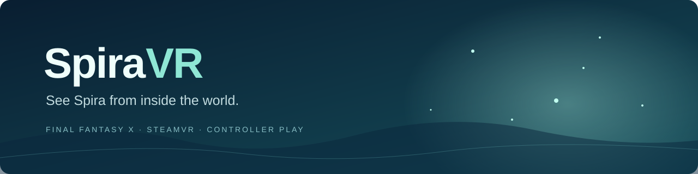

<p align="center"></p>

<p align="center">
  <b>Head-controlled FINAL FANTASY X for SteamVR.</b><br>
  Keep your controller. Look around the world. Return to desktop play whenever you want.
</p>

<p align="center">
  <a href="LICENSE">MIT license</a> ·
  <a href="docs/SETUP.md">Setup & recovery</a> ·
  <a href="docs/RECORDING.md">Recording guide</a> ·
  <a href="docs/COMPATIBILITY.md">Compatibility</a> ·
  <a href="docs/DEVELOPMENT.md">Build & contribute</a>
</p>

---

SpiraVR is an experimental Windows mod for **FINAL FANTASY X HD Remaster**.
It uses the game's existing world assets, rotates the in-game camera with your
headset, and submits the view directly to SteamVR. You still walk, fight, and
navigate menus with the game's normal controller controls.

**The recommended mode is a head-tracked monoscopic world.** Depth-based stereo
is optional and disabled by default because it can produce outlines around
models. Turning stereo off keeps head-controlled viewing and the VR UI.

This is an early, scene-dependent conversion. It is **not** a complete native
6DoF VR port: leaning does not move the game camera, motion controllers are not
used, and looking beyond the original camera can reveal missing scenery.

## What works

- **Look around Spira** using headset orientation, with a widened world projection.
- **Play with your existing controller** and familiar game controls.
- **Read menus in a forward viewing area** anchored to your recentered direction.
- **Keep battle target markers with their characters**, rather than on the UI panel.
- **Switch optional stereo on or off live**, without restarting or disabling head tracking.
- **Go back to normal desktop play**: the launcher removes the addon, restores
  snapshotted configuration, and verifies the original top-level game/mod files.

There is no Desktop+ dependency, background capture service, frame-rate unlock,
AI generation, or downloaded world content.

## Before installing

You need:

1. The Windows Steam version of FFX HD Remaster with the supported executable
   hash below. **FFX-2 is not supported.**
2. A working **Direct3D 11 rendering chain** and **ReShade with full addon support**.
   The development setup used ReShade **6.8.0**. SpiraVR does not install or replace
   your renderer, ReShade, or other mods.
3. SteamVR and a connected PC VR headset. The tested combination is **Quest 2
   through Steam Link**.
4. A normal game controller. A keyboard is useful for recentering.

The tested installation is modded, including its existing D3D11 path. A clean
Steam installation has not been validated as a complete setup recipe.
Read [compatibility](docs/COMPATIBILITY.md) before changing your game.

Supported `FFX.exe` SHA256:

```text
0537B2A1047F3266E73495CD4E35F63F0777F4231D417699F979954686DA686D
```

The launcher refuses other executable hashes before modifying the game folder.
Do not bypass that check: the camera hooks use build-specific addresses.

## Get started

Use a **SpiraVR runtime ZIP from [Releases](https://github.com/RobertTee93/spira-vr/releases)**
when available, or [build from source](docs/DEVELOPMENT.md). GitHub's source ZIP
does not contain the compiled addon or OpenVR runtime.

1. Extract SpiraVR into a writable folder outside the game installation.
2. Connect the headset and start SteamVR.
3. Close FFX, then run **`Start-SpiraVR.cmd`**. Steam libraries are detected automatically.
4. Load your save normally. Face forward and press **F8** while FFX has focus.
5. Keep the launcher running until you close FFX.

If the game is not detected:

```bat
Start-SpiraVR.cmd -GameDirectory "D:\SteamLibrary\steamapps\common\FINAL FANTASY FFX&FFX-2 HD Remaster"
```

See [setup](docs/SETUP.md) for a persistent custom path and desktop shortcuts.

## Controls

| Control | Action |
|---|---|
| Controller | Normal FFX gameplay and menu controls |
| **F8**, with FFX focused | Recenter your forward direction |
| **F9**, with FFX focused | Toggle head-controlled camera rotation |
| **Toggle-Stereo.cmd** | Toggle depth stereo live; head tracking stays enabled |
| **Ctrl + Alt + F7** | Stereo toggle after running `Install-Shortcuts.ps1` |
| Close FFX normally | Remove the temporary addon and restore original settings |

Stereo returns to its remembered intensity when enabled (20% initially).
Windows manages the optional shortcut hotkey; if it is intercepted, use the
desktop shortcut or `Toggle-Stereo.cmd`.

## Your mods and normal play

The launcher adds only its own `ffx-headlook.addon32` to the game folder.
It does not replace existing mod DLLs, game executables, or saves.
Before launch it copies top-level INI/CFG settings and hashes the relevant
game/mod files. After exit it restores those settings and verifies the hashes.
Only the latest successfully verified recovery snapshot is kept.

**Normal desktop play has been confirmed by the tester after closing VR.**
Start FFX through Steam as usual once restoration finishes.

If the launcher is interrupted, close FFX and run **`Restore-Normal.cmd`**.
Do not delete or move SpiraVR while a VR session is active.
Settings changed inside a VR session are restored to their pre-session values
on exit; saves are outside this snapshot mechanism.

### DLSS5 and other visual mods

The launcher preserves their installed files, but visual compatibility is
**experimental**, not guaranteed. The original tester preferred DLSS5 disabled
during VR after trying it. SpiraVR includes handling for the tested asynchronous
DLSS5 feed, but other versions and configurations have not been validated.

The public default, `DisableDLSS5=0`, leaves that setting alone. To temporarily
disable the tested feed during VR, set `DisableDLSS5=1` in `control.ini`;
the original config is restored on exit. It only edits an existing
`dlss5-feed.cfg` and does not remove the mod.

## What has been tested

User headset checks on Quest 2 / Steam Link confirmed camera direction,
recentring, controller walking and menus, the title/save-load menu, both friendly
and enemy battle target indicators, and the fix for jumps when cancelling the
save menu or advancing NPC dialogue. The tester accepted the monoscopic mode.

This is not a whole-game test pass. The cleaned portable build also needs to
remain clearly distinguished from those gameplay checks; see the
[verification notes](docs/COMPATIBILITY.md#verification).

Known limits include missing/off-camera geometry, game-controlled camera cuts,
the original game frame-rate cap, scene-specific UI detection, and stereo
artifacts around edges, effects, or transparencies.

## Show it to someone

Capture **SteamVR's single-eye VR View**, not the stretched FFX desktop window.
The [recording guide](docs/RECORDING.md) explains a clean OBS setup, aspect-ratio
handling, audio, and a short demonstration shot list.

## Contribute

Reports with the scene, reproduction steps, headset, renderer/mod versions,
and a short recording are especially useful. Please do not upload game files,
save files, private recovery snapshots, or raw texture/shader dumps.

See [development](docs/DEVELOPMENT.md) for the source layout and build process.
The original code is [MIT licensed](LICENSE); bundled dependencies retain their
[own licenses](THIRD-PARTY-NOTICES.md).

*Independent fan project. Not affiliated with Square Enix.*
